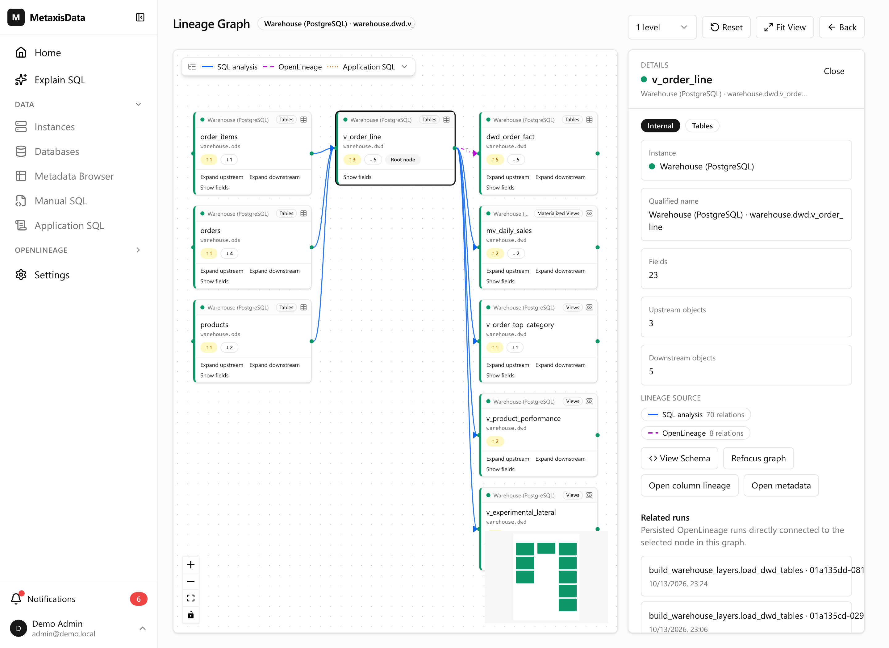
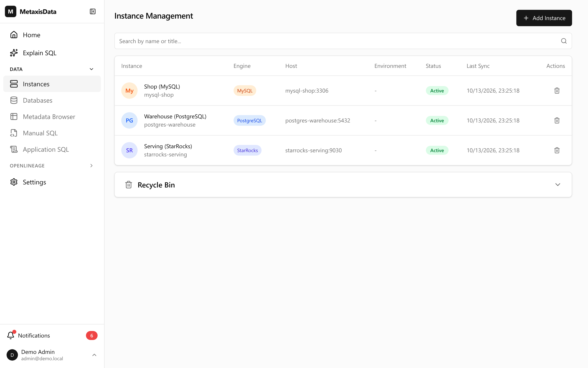
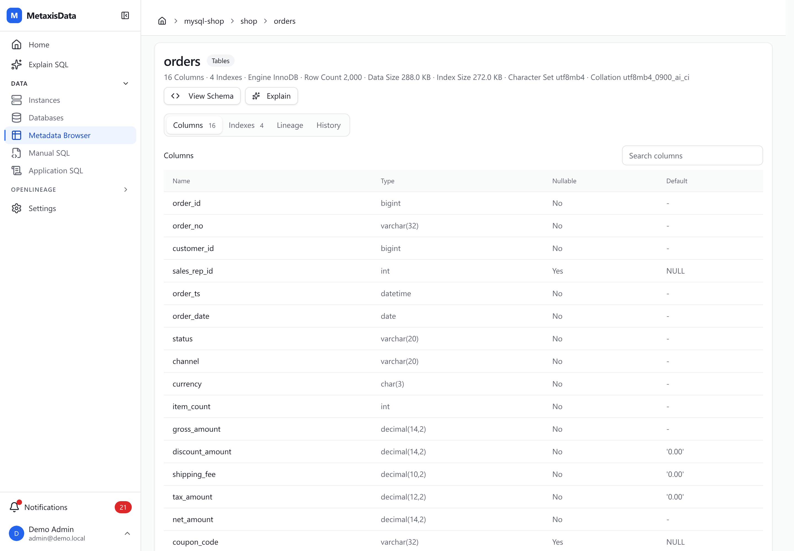
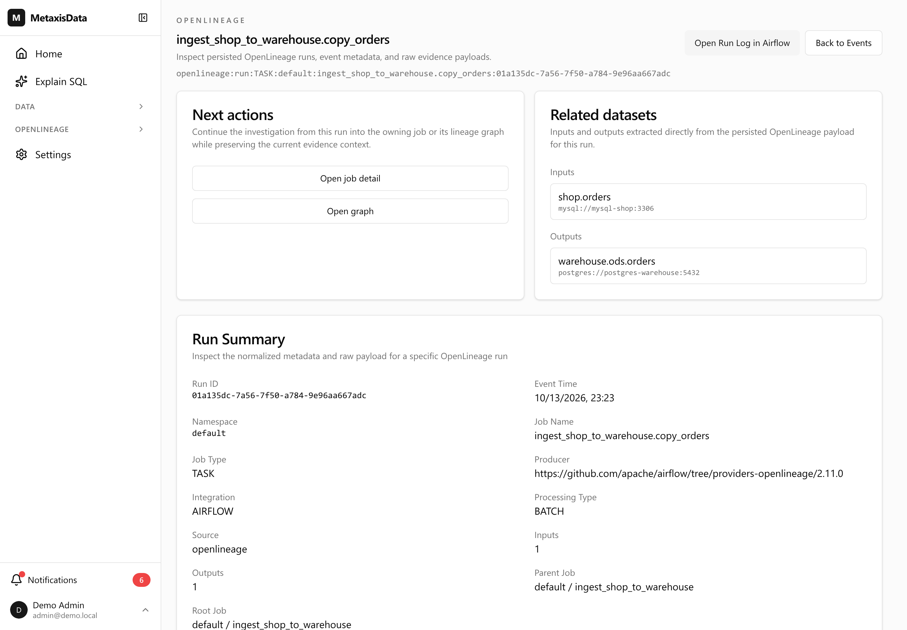

# metaxisdata demo

A ready-to-explore demo of **metaxisdata**, the self-hosted data governance and metadata platform.

One command brings up a small data platform — MySQL, PostgreSQL and StarRocks — plus an Airflow
pipeline and the platform itself, already loaded with data and lineage. You only have to look.

---

## Start it

You need **Docker** (with Compose v2), about **10 GB of free memory** and **8 GB of disk**, and
**ports 8083 and 8080 free**.

```bash
git clone <this repo> && cd metaxisdata-demo
make up
```

That is the whole setup. It builds one image, starts everything, seeds the databases, runs the
pipeline and feeds the platform. A first run takes about 5–10 minutes; later runs are much faster.

When it is ready, the last line says:

```
== smoke: the demo is populated
```

## Open it and sign in

| Open | Sign in |
| --- | --- |
| **<http://localhost:8083>** — metaxisdata | `admin@demo.local` / `Demo-admin-1234!` |
| **<http://localhost:8080>** — Airflow, the pipeline UI | `admin` / `admin` |

These are throwaway passwords for this local demo; nothing here is production-shaped.

## What you are looking at

```
  MySQL               PostgreSQL             StarRocks            Airflow
  mysql-shop    →     postgres-warehouse  →  starrocks-serving    :8080
  the shop's          the warehouse:         the serving layer:   runs the four
  orders & co.        ods → dwd → ads        views on top         pipeline steps
      │                     │                      │                  │
      └─────────────────────┴──────────────────────┘                  │
                            │                                         │
                            ▼                                         ▼
                  metaxisdata  :8083  ←───────────────────────────────┘
             collects every schema, and draws the lineage
```



---

## Take the tour

### 1. One registry, three different databases

**Data → Instances.** Three databases are registered and synced: `mysql-shop` (MySQL),
`postgres-warehouse` (PostgreSQL) and `starrocks-serving` (StarRocks).



Open **Metadata** and pick `shop.orders` in the MySQL instance: columns, types, indexes, DDL and
size. Then run

```bash
make evolve
```

which adds a column to that table and re-syncs. Back on the same table, open its **history**: the
change is recorded with a diff, summarised as `+1 column`.



### 2. Lineage that comes from SQL

Open **Metadata → postgres-warehouse → `warehouse.dwd.v_order_line`**, then its **Lineage**.

The warehouse's views and materialized views were created by the pipeline; the platform reads their
definitions and works the graph out on its own. Follow it upstream to `warehouse.ods.order_items`,
or downstream through `warehouse.dwd.mv_daily_sales` to `warehouse.ads.ads_daily_sales`. The edges
are labelled by what they do — `DIRECT`, `AGGREGATE`, `JOIN`, `GROUP` — and expanding a table shows
column-by-column trails.

### 3. Follow the chain end to end

Open **Metadata → `shop.orders`** (the MySQL one) and expand **Lineage** downstream. The chain walks
through all three engines:

```
shop.orders → warehouse.ods.orders → v_order_base / v_order_line
  → mv_daily_sales / dwd_* → StarRocks ods.dwd_order_fact → ads.v_sr_* / ads.mv_sr_region_daily
```

### 4. The same story, told by OpenLineage

Open **OpenLineage → Jobs** and open a run — for instance one of the `copy_*` tasks that moved a table
from the shop into the warehouse. You can see the datasets it read and wrote, each resolved to the
database that owns it, and an **Airflow** link straight to the task log.



### 5. Statements that are not views

**Manual SQL** holds a statement someone kept in a wiki instead of creating a view. **Application
SQL** holds the statements an application reported running, so you can see which application reads
which table. Both are already in the demo, and both appear in the lineage graph.

### 6. People and permissions

Under **Settings** there are **Users**, **Groups**, **Roles** and the **Audit Log** — every action
taken so far, your own included, is recorded there. **Notifications** in the sidebar collects what
the platform wanted to tell an administrator.

### 7. A producer from outside

The platform accepts OpenLineage events from anything that speaks the protocol. This one is a
synthetic Spark job reporting under a namespace that no database owns:

```bash
make ol-demo
```

The first event arrives as an `external:spark-prod:…` dataset, and the administrators get a
notification that the namespace is unmapped. The script then registers a namespace mapping and sends
the same event again: the datasets resolve to `starrocks-serving`, and the edge appears between two
real tables.

---

## Commands

| Command | What it does |
| --- | --- |
| `make up` | Start everything and wait until the demo is ready |
| `make smoke` | Check that the demo is populated |
| `make logs` | Follow the logs |
| `make down` | Stop it, keep the data |
| `make reset` | Stop it and delete the data; `make up` starts clean |
| `make evolve` | Add a column and re-sync, to see metadata history |
| `make ol-demo` | Run the outside producer, with and without a namespace mapping |

## If something goes wrong

| What you see | What to do |
| --- | --- |
| `make up` ends with a failure | Run `make smoke` — it names what is missing. `make logs` shows the stack. |
| It stops part-way, or a StarRocks step fails | StarRocks wants about 4 GB to itself. Give Docker more memory and run `make up` again. |
| A port is already taken | Set `METAXISDATA_PORT` or `AIRFLOW_PORT` in `.env`, then `make up`. |
| The first run is slow | It is pulling about 5 GB of images. Later runs start in seconds. |

## More

- [README.zh.md](README.zh.md) — the same guide in Chinese
- [.agent/docs/design.md](.agent/docs/design.md) — how this demo is put together, for maintainers
